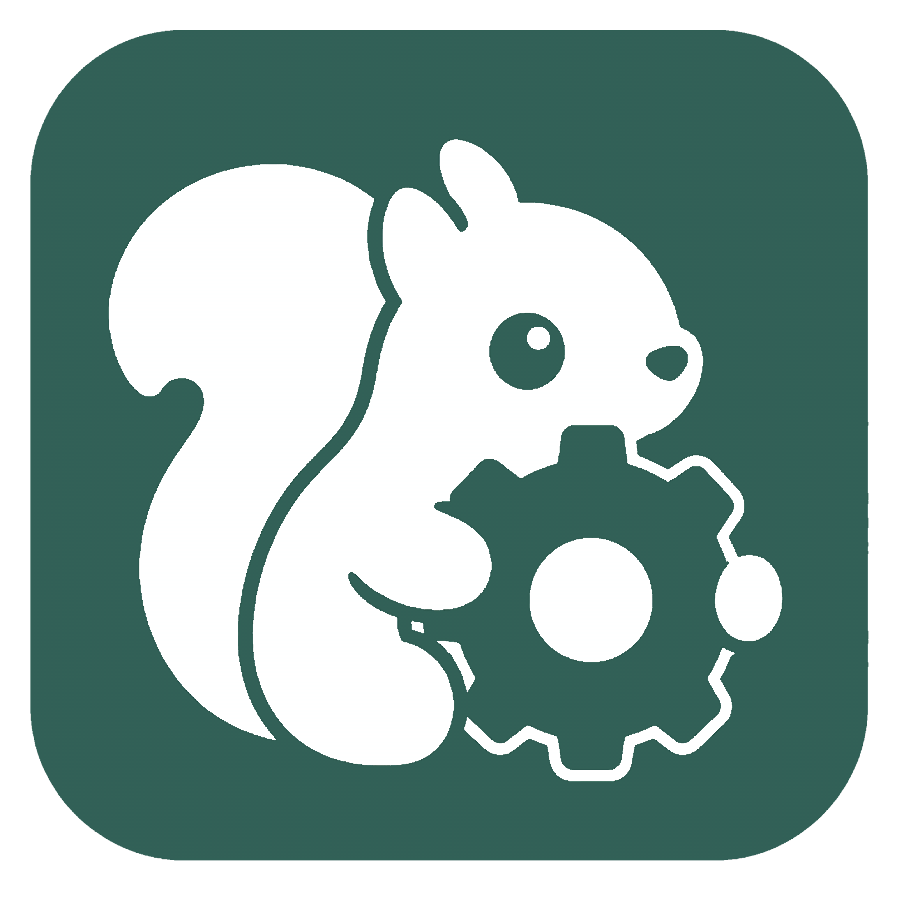

# Fluffy

[](#)
[](#)
[](#)
[](#)
[](#)
[](#)
[](#)
[](#)
[](#)

**Fluffy** - Социальная сеть c открытым исходным кодом.

<p align="center">
  
</p>

## Быстрый старт

### Предварительные требования

- Версия Python, совместимая с зафиксированными зависимостями (рекомендуется Python 3.12)
- Node.js версии `^22.18.0` или `>=24.12.0`
- Docker Compose
- учетные данные SMTP
- S3-совместимое хранилище (бакет)

### 1. Настройка окружения

Скопируйте файл `.env.example` в `.env` и замените все пустые значения на свои. Файл `.env` содержит конфиденциальные данные, поэтому его **не следует** добавлять в систему контроля версий (Git).

Бэкенд считывает **секретные данные и URL-адреса для подключений** из файла `.env`, а общие параметры работы приложения — из `config.yaml`. Описание всех обязательных переменных приведено в `.env.example`.

При запуске Python-приложения непосредственно на хостовой машине URL-адреса сервисов должны указывать на порты, доступные с хоста (например, `localhost:8080`). При запуске через Compose внутри контейнеров в качестве URL-адресов необходимо использовать имена сервисов Compose (например, `db`, `redis` и `rabbitmq`).

### 2. Запуск проекта

```bash
docker compose --profile prod up --build -d
# запуск контейнеров
dokcer compose --profile prod exec api alembic upgrade head
# применение миграций
```

### 2.1 Приложение
После этого API будет доступно по адресу `http://localhost:8000`, а сам вебсайт будет запущен на порту nginx (`http://localhost:8080`).

### 2.2 Документация
Интерактивная документация FastAPI будет доступна по адресу `http://localhost:8000/docs`. Документация redoc будет доступна по адресу: `http://localhost:8000/redoc`.
Документация openapi json будет доступна по адресу `http://localhost:8000/openapi.json`.

### 3. Запуск фронтенда (для разработки)

Если бекенд уже запущен, но вы решили править директорию `frontend/` во время разработки и хотите сразу видеть изменения,
тогда откройте другое окно терминала и перейдите в директорию.

```bash
cd frontend
npm ci
npm run dev
```

Локальный URL-адрес Vite отобразится в терминале (обычно это `http://localhost:5173`). Фронтенд ожидает, что API будет доступен по адресу `http://localhost:8000`; если ваша локальная конфигурация отличается, проверьте настройки API-клиента или прокси-сервера во фронтенде.

## Docker Compose

В файле `docker-compose.yml` определены `prod` и `test` для работы и тестирования. **Это вспомогательные профили, а не готовые решения для полноценной подготовки системы к продакшену.**

Профиль `test` создан только для запуска тестов, когда профиль `prod` создан для работы с проектом.

Для запуска тестов рекомендуется ознакомиться с [руководством по запуску тестов](tests/readme.md)

Файлы ревизий alembic расположены в директории `migrations/versions/`. Перед применением миграций и работе с ними рекомендуется ознакомиться с
[руководством по миграциями](migrations/README)

## Миграции базы данных

Файлы ревизий Alembic находятся в директории `migrations/versions/`.

Перед внесением или применением изменений в схему базы данных ознакомьтесь с [руководством по миграциям](docs/migrations_guide.md).

## Лицензия и контакты

Проект распространяется по лицензии [Apache v2.0](LICENSE)

Все визуальные материалы, включая логотип проекта, расположенный в папке `assets/` (в корневом каталоге проекта), защищены авторским правом и являются исключительной собственностью ghostfaccee (автора проекта).

Использование логотипа разрешено только в рамках данного проекта (например, при создании документации или внесении вклада в репозиторий).

Любое другое использование — включая копирование, изменение, распространение, передачу прав третьим лицам (сублицензирование) или коммерческое использование — строго запрещено без прямого письменного разрешения автора.

По вопросам получения разрешения обращайтесь по адресу: ghostface.host@gmail.com.

По вопросам проекта (баг-репорты, идеи и тд.) можете обращаться по адресу: fluffy.social.network@gmail.com.